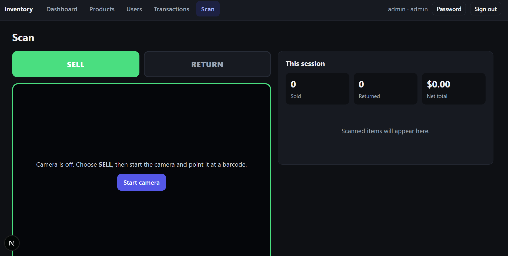
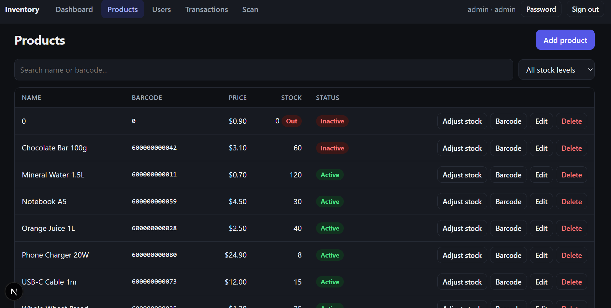
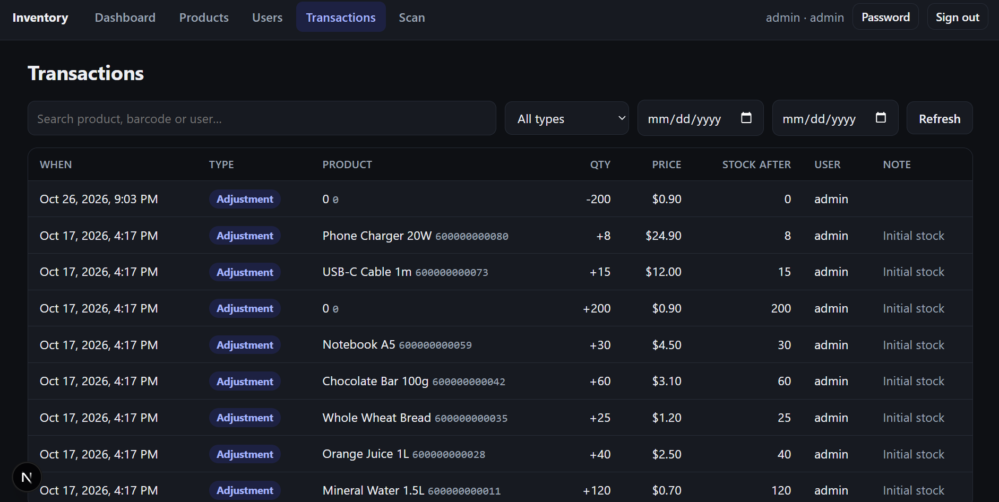
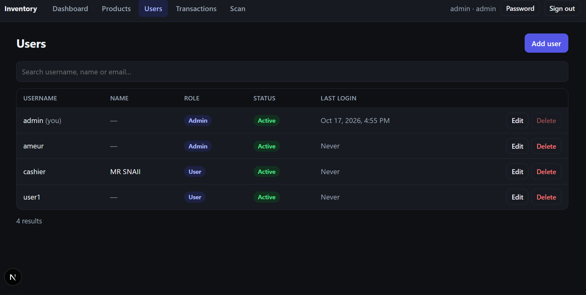

# Inventory Management System

A full-stack inventory app built with **Django (REST API)** and **Next.js (React UI)**.

- An **admin** controls everything: products, stock, users, and the full transaction history.
- Regular **users** can do exactly one thing: **scan a barcode with the camera to sell or return an item**. Stock is counted automatically on every scan.

```
┌────────────────────┐   /api/*    ┌────────────────────┐   ┌──────────┐
│  Next.js frontend  │ ──────────▶ │  Django REST API   │──▶│ Database │
│  (camera scanner)  │  (proxied)  │  JWT auth + roles  │   │ (SQLite) │
└────────────────────┘             └────────────────────┘   └──────────┘
```

## Screenshots

<table>
  <tr>
    <td align="center" width="50%">
      
      <br /><sub><b>Scan:</b> SELL / RETURN switch, live camera scanner and session totals</sub>
    </td>
    <td align="center" width="50%">
      
      <br /><sub><b>Products:</b> search, stock status, adjust stock, barcode labels</sub>
    </td>
  </tr>
  <tr>
    <td align="center" width="50%">
      
      <br /><sub><b>Transactions:</b> full audit trail with type, date and text filters</sub>
    </td>
    <td align="center" width="50%">
      
      <br /><sub><b>Users:</b> roles, active status and last login</sub>
    </td>
  </tr>
  <tr>
    <td align="center" colspan="2">
      
      <br /><sub><b>Django admin:</b> emergency back-office at <code>/django-admin/</code></sub>
    </td>
  </tr>
</table>

## Features

**Admin**
- Dashboard: sold/returned today, revenue, units in stock, stock value, low/out-of-stock counts, 7-day chart, restock list, top sellers
- Products: add / edit / delete / deactivate, search, low-stock filters, audited stock adjustments, printable barcode labels
- Users: create, edit, change role, reset password, deactivate, delete
- Transactions: every sale, return and adjustment with who/when/price, filterable by type, date and text

**Users (cashiers)**
- Big **SELL / RETURN** switch, live camera scanner, instant feedback (colour flash, beep, vibration)
- Each scan = one unit; stock updates automatically
- Session log with running totals, plus a personal history page
- No access to products, users, stats, or anyone else's transactions (enforced by the API, not just hidden in the UI)

## Roles and permissions

| Capability                                   | Admin | User |
| -------------------------------------------- | :---: | :--: |
| Scan to sell / return                        |  ✅   |  ✅  |
| See own transaction history                  |  ✅   |  ✅  |
| See all transactions                         |  ✅   |  ❌  |
| Create / edit / delete products, adjust stock|  ✅   |  ❌  |
| Manage users and roles                       |  ✅   |  ❌  |
| Dashboard and statistics                     |  ✅   |  ❌  |

Roles are checked against the database on **every request**, so deactivating or demoting someone takes effect immediately, even if they still hold a valid token.

## Tech stack

- **Backend:** Django 5, Django REST Framework, SimpleJWT, django-cors-headers, SQLite (PostgreSQL recommended for production)
- **Frontend:** Next.js 15 (App Router), React 19, TypeScript, [`@zxing/browser`](https://github.com/zxing-js/browser) for camera scanning, JsBarcode for label generation

## Project structure

```
inventory-system/
├── backend/
│   ├── config/                 # Django settings, urls
│   ├── inventory/
│   │   ├── models.py           # User (roles), Product, Transaction
│   │   ├── views.py            # API views incl. the atomic scan endpoint
│   │   ├── serializers.py
│   │   ├── permissions.py      # IsAdminRole
│   │   ├── tests.py            # 28 tests
│   │   └── management/commands/seed_demo.py
│   ├── requirements.txt
│   └── .env
└── frontend/
    ├── src/app/                # Pages: login, scan, history, admin/*
    ├── src/components/         # Scanner, Modal, TransactionsTable, ...
    ├── src/lib/                # API client (JWT + refresh), auth context
    ├── next.config.mjs         # /api/* proxy to Django
    └── .env.local.example
```

## Quick start

You need **Python 3.10+** and **Node.js 18.18+**.

### 1. Backend

```bash
cd backend
python -m venv .venv
source .venv/bin/activate          # Windows: .venv\Scripts\activate
pip install -r requirements.txt

python manage.py migrate
python manage.py seed_demo         # demo accounts + 8 sample products (dev only)
python manage.py runserver         # http://127.0.0.1:8000
```

`seed_demo` creates:

| Username  | Password       | Role  |
| --------- | -------------- | ----- |
| `admin`   | `admin12345`   | Admin |
| `cashier` | `cashier12345` | User  |

**Change these before putting the app anywhere real.** For your own admin instead of the demo one:

```bash
python manage.py createsuperuser   # superusers are automatically admins
```

### 2. Frontend

In a second terminal:

```bash
cd frontend
npm install
cp .env.local.example .env.local   # optional: defaults work out of the box
npm run dev                        # http://localhost:3000
```

Open <http://localhost:3000> and sign in.

> The frontend forwards `/api/*` to Django (`BACKEND_URL`, default `http://127.0.0.1:8000`), so there is **no CORS setup** and the browser only ever talks to one origin.

## How scanning works

1. Sign in as a user and open **Scan**.
2. Pick **SELL** or **RETURN** (the camera frame and banner change colour so you always know the mode).
3. Press **Start camera** and point it at a barcode. On a phone it uses the rear camera.
4. Each successful read changes stock by exactly **one unit** and shows the product, price and remaining stock.

Rules enforced by the server (in one atomic database transaction, so stock and the audit log can never disagree):

- **Can't oversell.** A sale only succeeds while stock is ≥ 1. Two cashiers scanning the last unit at the same moment can't both succeed.
- **Returns must match sales.** For each product, returned units can never exceed sold units, so stock can't be inflated by repeatedly scanning "return".
- **Unknown or inactive products are rejected** with a clear message.
- Every change is recorded in the transaction log with the user, time, price at that moment, and resulting stock.

**Double-scan protection.** A camera sees the same barcode many times per second. After a scan, the same code is ignored for 1.5 seconds (`COOLDOWN_MS` in `frontend/src/app/(app)/scan/page.tsx`), so one item held in view counts once. To count several identical items, scan one, pull it away, bring the next.

**Supported formats:** EAN-13, EAN-8, UPC-A, UPC-E, Code 128, Code 39, ITF and QR codes (edit `FORMATS` in `components/Scanner.tsx` to change).

### Camera requirements

Browsers only allow camera access on **HTTPS or `localhost`**. That's fine on your own computer, but to test from a phone on your Wi-Fi you need HTTPS:

```bash
# frontend/.env.local
ALLOWED_DEV_ORIGINS=192.168.1.20        # your computer's LAN IP

cd frontend
npm run dev:https                        # next dev with a local HTTPS certificate
```

Then open `https://192.168.1.20:3000` on the phone and accept the self-signed certificate warning. Only the frontend needs to be reachable: Django keeps listening on `127.0.0.1` because Next proxies the API calls. For production, serve everything behind a normal HTTPS domain.

### Testing without printed products

In **Admin → Products**, click **Barcode** on any product to display a scannable Code 128 barcode (with a Print button for labels). Point the phone at your computer screen, or print the label and stick it on the item. Real products can use the number printed on their packaging.

### Hardware barcode scanners

USB/Bluetooth scanners behave like a keyboard. The Scan page has an input box that accepts them (scan → Enter). If you want items to be scannable **only with the camera**, hide that box:

```bash
# frontend/.env.local
NEXT_PUBLIC_ALLOW_MANUAL_ENTRY=false
```

(Rebuild or restart the frontend after changing `NEXT_PUBLIC_*` variables.)

## Admin guide

- **Add a product:** Products → *Add product*. The initial stock is logged as an adjustment, so the history always explains the current quantity.
- **Change stock:** *Adjust stock* (e.g. `+24` restock, `-3` damaged). Quantity can't be edited directly, which keeps the audit trail honest. Stock can't go below zero.
- **Delete vs deactivate:** a product or user with transaction history can't be deleted (history is never rewritten). Mark it **inactive** instead: inactive products can't be scanned and inactive users can't sign in.
- **Roles:** *User* = scan only. *Admin* = everything. You can't demote, deactivate or delete your own account, so you can't lock yourself out.
- **Low-stock warning:** each product has its own threshold; it feeds the dashboard and the *Low stock* filter.

## API reference

Base path `/api`, JSON in and out, `Authorization: Bearer <access token>` on everything except login/refresh. Lists are paginated (`?page=`, `?page_size=` up to 100).

| Method & path                         | Who        | Description |
| ------------------------------------- | ---------- | ----------- |
| `POST /auth/login`                    | public     | `{username, password}` → `{access, refresh, user}` |
| `POST /auth/refresh`                  | public     | `{refresh}` → new `access` (+ rotated `refresh`) |
| `GET /auth/me`                        | any user   | Current user |
| `POST /auth/change-password`          | any user   | `{old_password, new_password}` |
| `POST /scan`                          | any user   | `{barcode, action: "sell" \| "return"}` → transaction + product stock |
| `GET /transactions`                   | any user*  | History. Filters: `type`, `product`, `user`†, `date_from`, `date_to`, `search`. *Users see only their own. †admin only |
| `GET/POST /products`                  | admin      | List (`search`, `stock=low\|out`, `ordering`) / create |
| `GET/PATCH/DELETE /products/{id}`     | admin      | Read / update / delete |
| `POST /products/{id}/adjust`          | admin      | `{delta, note?}` audited stock change |
| `GET/POST /users`                     | admin      | List (`search`) / create |
| `GET/PATCH/DELETE /users/{id}`        | admin      | Read / update / delete |
| `GET /stats`                          | admin      | Dashboard numbers |

Status codes worth knowing: `404` unknown barcode, `409` out of stock / nothing to return / inactive product / delete blocked by history, `403` wrong role, `401` missing or expired token.

Quick check with curl:

```bash
TOKEN=$(curl -s -X POST localhost:8000/api/auth/login \
  -H 'Content-Type: application/json' \
  -d '{"username":"cashier","password":"cashier12345"}' | python -c "import sys,json;print(json.load(sys.stdin)['access'])")

curl -X POST localhost:8000/api/scan \
  -H "Authorization: Bearer $TOKEN" -H 'Content-Type: application/json' \
  -d '{"barcode":"600000000011","action":"sell"}'
```

## Configuration

**Backend** (environment variables, see `backend/.env.example`)

| Variable                | Default                          | Purpose |
| ----------------------- | -------------------------------- | ------- |
| `DJANGO_DEBUG`          | `1`                              | Set `0` in production |
| `DJANGO_SECRET_KEY`     | dev-only key                     | **Required** when `DJANGO_DEBUG=0` |
| `DJANGO_ALLOWED_HOSTS`  | `localhost,127.0.0.1,[::1]`      | Comma-separated hostnames |
| `DJANGO_TIME_ZONE`      | `UTC`                            | Decides what "today" means on the dashboard, e.g. `Africa/Tunis` |
| `CORS_ALLOWED_ORIGINS`  | `http://localhost:3000,...`      | Only needed if the browser calls Django directly |
| `DATABASE_PATH`         | `backend/db.sqlite3`             | SQLite file location |

**Frontend** (`frontend/.env.local`, see `.env.local.example`)

| Variable                         | Default                 | Purpose |
| -------------------------------- | ----------------------- | ------- |
| `BACKEND_URL`                    | `http://127.0.0.1:8000` | Where Next forwards `/api/*` |
| `NEXT_PUBLIC_API_URL`            | *(unset = use proxy)*   | Call Django directly instead (then configure CORS) |
| `NEXT_PUBLIC_CURRENCY`           | `USD`                   | ISO currency code for prices (e.g. `TND`, `EUR`) |
| `NEXT_PUBLIC_ALLOW_MANUAL_ENTRY` | `true`                  | `false` = camera-only scanning |
| `ALLOWED_DEV_ORIGINS`            | *(none)*                | Dev only: LAN IP for phone testing |

Prices are stored with 3 decimal places, so currencies such as TND and KWD work as well as 2-decimal ones.

## Running the tests

```bash
cd backend
python manage.py test
```

The 28 tests cover scan rules (oversell, return limits, unknown/inactive products), role permissions on every admin endpoint, "users only see their own history", immediate lockout of deactivated users, stock-adjustment rules, deletion protection, and dashboard maths.

Frontend checks: `npm run typecheck` and `npm run build`.

## Deploying to production

A checklist rather than a one-click recipe, because hosting differs:

1. **Database:** switch `DATABASES` in `backend/config/settings.py` to PostgreSQL (`pip install psycopg[binary]`). The scan endpoint is race-safe on SQLite too, but PostgreSQL gives you proper row locking and concurrent writers.
2. **Django:** `DJANGO_DEBUG=0`, a strong `DJANGO_SECRET_KEY`, real `DJANGO_ALLOWED_HOSTS`; run with `gunicorn config.wsgi` behind a reverse proxy (Nginx, Caddy, ...) that terminates HTTPS and sets `X-Forwarded-Proto`. Run `python manage.py collectstatic` if you use `/django-admin/`.
3. **Next.js:** `npm run build && npm run start`, with `BACKEND_URL` pointing at Django. Serve it over HTTPS (required for the camera).
4. **Accounts:** delete or change the demo users, create a real admin with `createsuperuser`.
5. **Tokens:** the UI stores JWTs in `localStorage` for simplicity (access token 30 min, refresh token 7 days, rotated on refresh). That is standard for this kind of app but exposes tokens to any XSS bug; for stricter setups move them to `httpOnly` cookies.
6. **Backups:** the transaction table is your audit trail; back the database up.

## Design notes and limits

- **Append-only history.** Transactions are never edited or deleted through the app or the Django admin, and each stores the price at the time of the sale.
- **One unit per scan.** Selling 5 of the same item means 5 scans. (The API's data model already stores a signed quantity, so adding "quantity" later is a small change.)
- **Returns are tied to products, not receipts.** The rule is "you can't return more units than were sold", not "this specific customer bought it". Per-receipt returns would need a basket/receipt concept.
- **Django admin** is available at `/django-admin/` for emergencies, but day-to-day work happens in the Next.js admin.

## Troubleshooting

| Problem | Fix |
| ------- | --- |
| "Camera access needs HTTPS" | Use `localhost` on the same computer, or `npm run dev:https` / a real HTTPS domain on other devices |
| Camera permission denied | Allow camera for the site in the browser's site settings, then press **Start camera** again |
| Barcode not detected | More light, hold 10-20 cm away, avoid glare, keep the barcode inside the dashed frame; try another camera from the dropdown |
| `No product with barcode …` | The barcode isn't registered. Add it under Admin → Products (barcodes must match exactly) |
| Login works but pages show network errors | Django isn't running, or `BACKEND_URL` is wrong |
| `ImproperlyConfigured: Set DJANGO_SECRET_KEY` | You set `DJANGO_DEBUG=0` without a secret key |
| Phone can't load the dev server | Set `ALLOWED_DEV_ORIGINS` to your LAN IP and run `npm run dev:https` |
